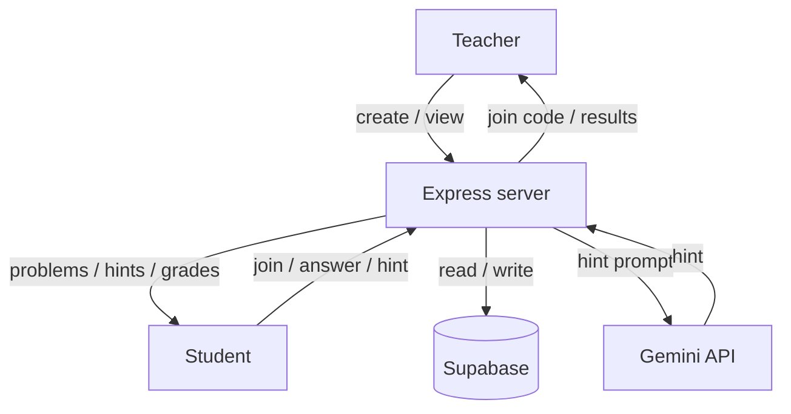

# Architecture 

## Workflow
1. Teacher opens the teacher page, enters the passcode, and creates an assignment:
   title, time limit, and 1-10 problems each with an answer key. The server returns a 6-character join code.
2. Student opens the home page, enters the code and a name, and sees the problems (no answer keys).
3. Student works each problem. They can ask the tutor for hints at any time.
4. On submit, the server grades each answer against the hidden key and stores the results.
5. Teacher views per-student scores, answers, and the tutor chat log.

## Architecture diagram

## Components
- Browser pages (`public/`): vanilla HTML/JS. `student.js` runs the join flow, countdown timer (auto-submits at zero), a separate tutor chat per problem, and submission. `teacher.js` handles passcode sign-in, assignment creation, and the results/chat-log view. Pages build the DOM with `textContent`, never `innerHTML`, so student text cannot inject markup.
- Express server (`server.js`): routes, validation, teacher passcode check, grading.
- Supabase: assignments, problems (with answer keys), submissions, submission_answers, chat_messages.
- Gemini: generates hints. The server builds the prompt from the stored problem and key.

## Data and model

The prototype does not train a model or load the MathLake dataset. Teachers enter the pre-algebra questions and answer keys when they create an assignment; the app stores them in Supabase. For evaluation, the team uses sample problems and simulated student messages.

When a student asks for a hint, the Express server sends Gemini a prompt containing the problem and its confidential answer key. The app uses the `@google/genai` package and defaults to `gemini-3.5-flash`, configurable through `GEMINI_MODEL`. The server checks Gemini’s reply with an answer-leak guard, retries once if it detects the answer, and then uses a fallback reply if needed.

## Tutor flow (POST /api/chat)
1. Server looks up the assignment and problem by code and problem id (client cannot change them).
2. System prompt = problem + confidential answer key + hint-only rules (`lib/tutor.js`).
3. Gemini replies. `revealsAnswer()` checks the reply for the final answer.
4. If it leaks: regenerate once with a reminder; if it leaks again, send a safe fallback message.
5. The student message and tutor reply are logged to `chat_messages`.

## Known limitations (so far)
- Teacher passcode is a single shared secret, not per-teacher accounts.
- Algebraic expressions are compared as normalized text, not symbolically.
- The leak guard is a heuristic and can miss reworded answers.

## Completed vs planned
Completed: teacher assignment creation with answer keys, join codes, student problem page with timer,
hint-only tutor chat with answer-leak guard, server-side grading, teacher results and chat log, unit tests.

Planned / not done: photo-scan answer keys (teacher confirms parsed key), AI-generated exercises,
symbolic answer checking, per-teacher accounts, a formal tutor evaluation across more problems.
